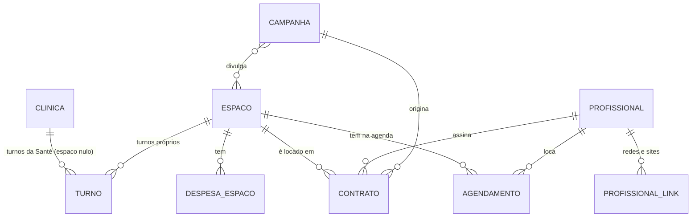
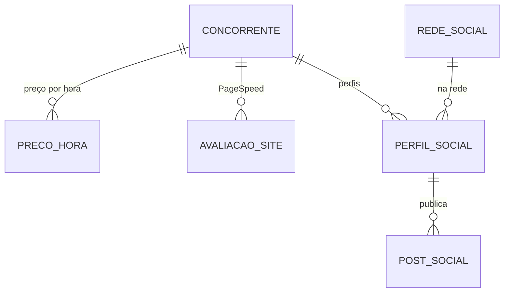

# Modelo de dados

O banco guarda tudo o que o Santé Admin usa hoje: o `public/data/sante.json` e os arquivos de mercado `src/data/concorrentes.json` e `src/data/social.json`. Os modelos ficam em [app/models](../app/models) e as migrações em [migrations/models](../migrations/models).

## Casa e operação



| Tabela | No front | O que guarda |
|---|---|---|
| `clinica` | `meta`, `metas`, `custos.impostos/comissoes`, `turnos.minimo` | Dados da Santé, meta de ocupação, impostos e comissões (frações de 0 a 1) e o mínimo de turnos por reserva. Tem uma linha só. |
| `turno` | `turnos.horarios` e `espacos[].agenda.horarios` | Horários locáveis. Com `espaco_id` nulo, é um turno da Santé, usado por todas as salas sem turnos próprios. `dias` segue o `getDay()` do JavaScript: 0 = domingo, 6 = sábado. |
| `espaco` | `espacos` | Sala, piscina ou administrativo (centro de custo): modalidade, preço, valor pedido por turno e se tem turnos próprios. |
| `despesa_espaco` | `espacos[].despesas` | Despesas próprias de cada espaço. |
| `custo_fixo` | `custos.fixos` | Custos fixos mensais da casa. |
| `profissional` | `profissionais` | Locatários. |
| `profissional_link` | `profissionais[].redes` e `.outras` | Uma linha por rede social ou site. `rede = 'outra'` usa o rótulo. |
| `contrato` | `contratos` | Locação recorrente: unidades por mês, preço, início e término. |
| `agendamento` | `agendamentos` | Turnos de um dia na agenda. `tipo = locacao` é um turno locado; `tipo = bloqueio` é "Não disponível" e sai da capacidade do mês. `slots` é uma lista de `"08:00-12:00"`. `grupo` liga os dias criados por "repetir". |
| `campanha` / `campanha_espaco` | `campanhas` | Campanhas de marketing e os espaços que cada uma divulga. |

## Mercado



| Tabela | No front | O que guarda |
|---|---|---|
| `coleta` | `coletadoEm`, `nota` | Data e nota de cada coleta manual (`concorrentes`, `social`). |
| `concorrente` | `concorrentes.players` | Players de Maceió. A própria Santé tem `proprio = true`. |
| `preco_hora`, `busca_mapa`, `avaliacao_site`, `trafego_site` | `precoHora`, `mapas`, `sites`, `similarweb` | Comparativos da Análise de mercado. |
| `rede_social`, `perfil_social`, `post_social`, `busca_youtube` | `social.json` | Monitor social: redes, perfis, posts e buscas no YouTube. |

## Regras da agenda (iguais às do front)

O cálculo fica em [app/services/capacidade.py](../app/services/capacidade.py) e sai em `GET /api/espacos/{id}/capacidade?mes=AAAA-MM`.

- **No calendário:** turnos que abrem em cada dia do mês. Novembro de 2026, com a agenda da Santé: 21 dias úteis × 3 turnos + 4 sábados × 2 turnos = 71.
- **Não disponíveis:** agendamentos do tipo bloqueio que não foram cancelados, contados só em turnos que abrem naquele dia.
- **Em aberto:** no calendário menos não disponíveis. É a capacidade prática, base de todas as taxas de ocupação.
- **Ocupados:** turnos locados. **Livres:** em aberto menos ocupados.
- **Receita não realizada:** não disponíveis × valor por turno.
- Salas que cobram por hora contam horas. Salas mensais e o administrativo não usam agenda e devolvem a capacidade cadastrada.
- A API recusa:
  - um turno que a sala não abre naquele dia (422);
  - um turno já ocupado ou bloqueado (409);
  - um agendamento em sala mensal (422).

## Mudando o modelo

1. Altere os modelos em `app/models`.
2. Gere a migração:

   ```bash
   docker compose exec api aerich migrate --name descricao_curta
   ```

3. Aplique:

   ```bash
   docker compose exec api aerich upgrade
   ```

   O container também aplica as migrações pendentes sempre que sobe.
4. Faça commit do arquivo novo em `migrations/models`.

## Papel só de leitura

A migração `papel_somente_leitura` cria o papel `sante_leitura`, com `SELECT` em todas as tabelas
(inclusive as criadas depois). A ferramenta de consultas (`/api/banco/*`) conecta com ele, numa
transação `READ ONLY`. Assim, o banco recusa qualquer escrita feita por ali, mesmo que a API tenha um erro.
